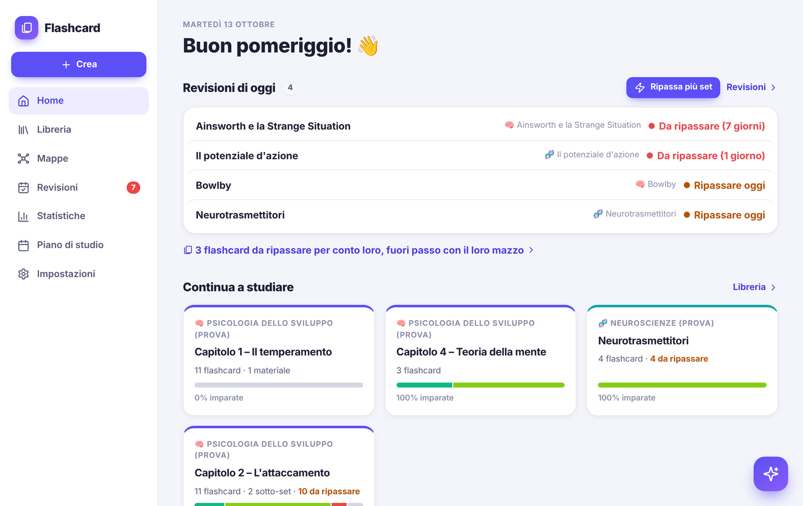
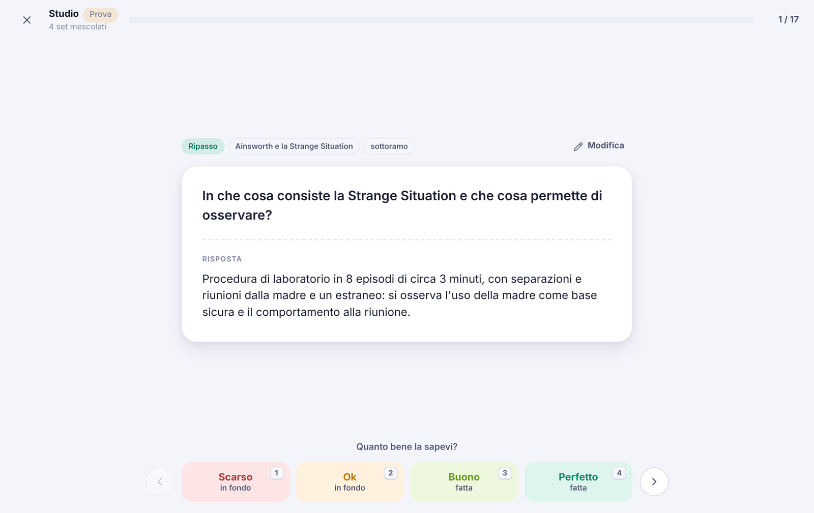
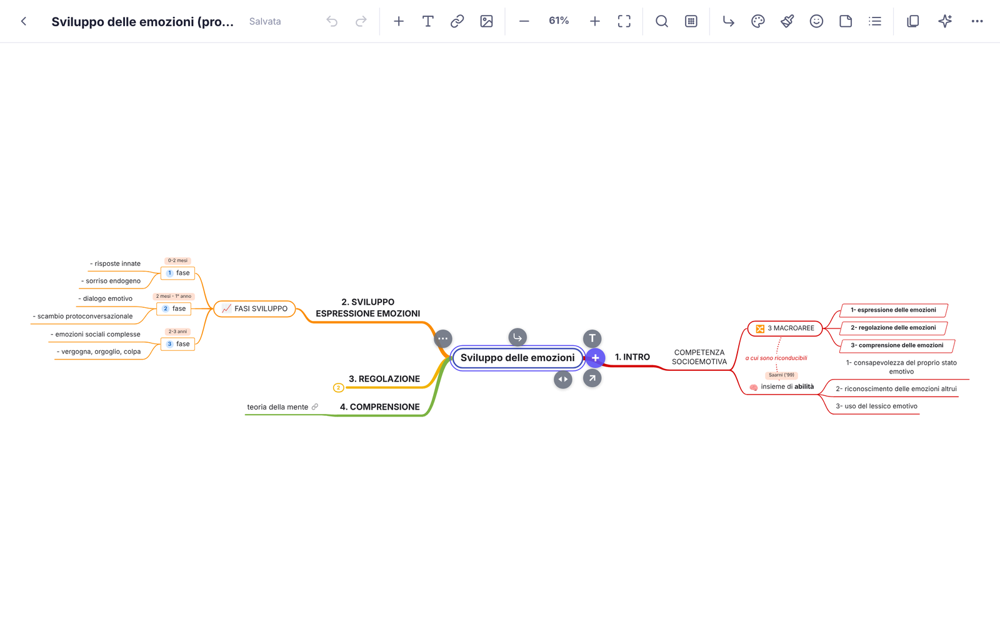
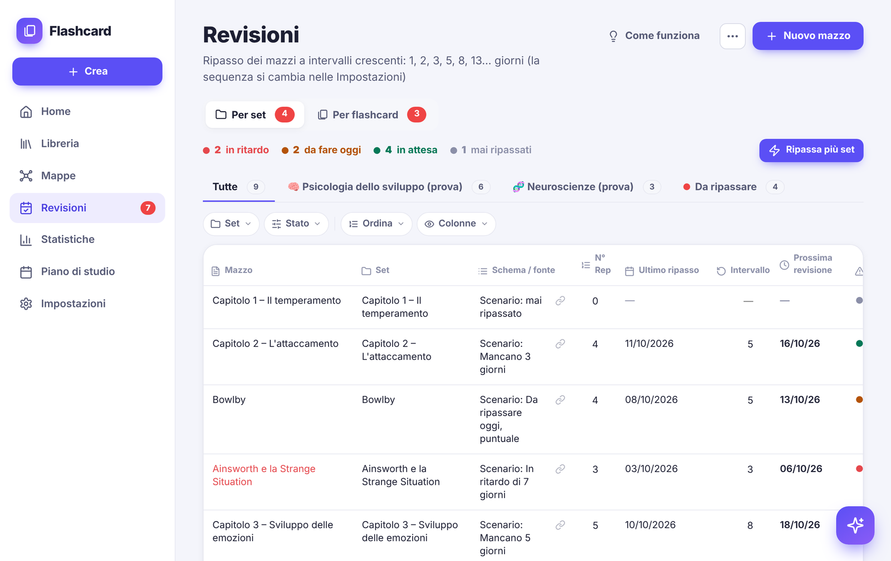
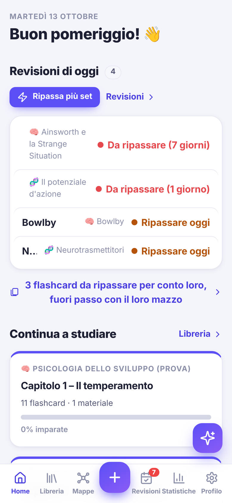

# Flashcard

Web app per studiare all'università con le flashcard e la **ripetizione spaziata**: organizza le materie, programma i ripassi e collega ogni risposta alla mappa mentale da cui viene.
L'ho progettata e sviluppata da solo con **Claude Code** per il mio studio di psicologia, e la uso da PC e da telefono.

**Online:** [flashcard-ale.web.app](https://flashcard-ale.web.app) · l'accesso è riservato al mio account Google, perché contiene i miei dati di studio. Le schermate qui sotto usano i dati di prova inclusi nell'app.

## Cosa fa

- **Libreria** per materie, set e sotto-set, con ricerca su tutto il testo.
- **Studio** con valutazione di ogni carta (Scarso, Ok, Buono, Perfetto) e possibilità di correggere una carta senza interrompere il ripasso.
- **Revisioni programmate** a intervalli crescenti (sequenza di Fibonacci) che si adattano a ritardi e anticipi, con un simulatore che mostra come cambiano le date.
- **Mappe mentali** con un editor completo: ogni flashcard può essere collegata al nodo della mappa che contiene la risposta, e nello studio la mappa compare sotto la risposta.
- **Materiali di studio** in ogni set (PDF, slide, Word, immagini, note), con le carte collegate al punto della fonte.
- **Assistente IA (Gemini)** a cui chiedi in chat di fare le operazioni dell'app: crea flashcard dai materiali, modifica le mappe, risponde sui contenuti. Ogni azione si può annullare.
- **Statistiche**, calendario dello studio e **piano degli esami** con conto alla rovescia.
- **Sincronizzazione** tra PC e telefono, con una copia dei dati sul dispositivo; si aggiunge alla schermata Home del telefono come un'app.

| Studio | Mappa mentale |
|---|---|
|  |  |

| Revisioni |
|---|
|  |

| Da telefono |
|:---:|
|  |

## Come è fatta

- **HTML, CSS e JavaScript** senza framework né passaggi di compilazione.
- **Firebase**: accesso con Google (Authentication), dati in Firestore, file in Cloud Storage, sito su Hosting. Le regole di sicurezza permettono la lettura e la scrittura solo al proprietario.
- **IndexedDB** per tenere i dati anche sul dispositivo; le modifiche si mettono in coda e partono appena c'è rete.
- **API di Gemini** per l'assistente. La chiave la inserisce l'utente e resta sul suo dispositivo, non è nel codice.

La documentazione completa delle funzioni è in [LEGGIMI.md](LEGGIMI.md); come pubblicarla su un proprio progetto Firebase è in [ISTRUZIONI-FIREBASE.md](ISTRUZIONI-FIREBASE.md).

## Autore

Alessandro Pillot · [alessandropillot01@gmail.com](mailto:alessandropillot01@gmail.com)
